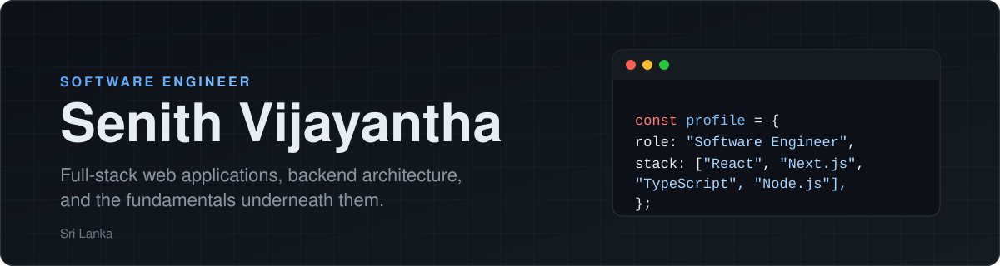

 

**Software Engineer** &middot; Software Technology undergraduate &middot; Sri Lanka

 

 

## About

I'm a Software Technology undergraduate in Sri Lanka and a software engineering intern at **APP360**, where I work on real-world web applications. I'm currently working with React, Next.js, TypeScript, Node.js, and modern web tooling.

I like building practical software and want to understand the fundamentals behind it: how data is modelled, how APIs are structured, and why a system behaves the way it does. Lately I've been working through backend architecture, data structures and algorithms, and how AI tools fit into the way software gets built.

## Technical Stack

<table>
  <tr>
    <td width="170"><b>Frontend</b></td>
    <td></td>
  </tr>
  <tr>
    <td><b>Backend</b></td>
    <td></td>
  </tr>
  <tr>
    <td><b>Languages</b></td>
    <td></td>
  </tr>
  <tr>
    <td><b>Databases</b></td>
    <td></td>
  </tr>
  <tr>
    <td><b>Tools &amp; Platforms</b></td>
    <td></td>
  </tr>
  <tr>
    <td><b>AI development</b></td>
    <td>
      Working with AI coding assistants and agent skills, and building a terminal coding agent (<a href="#featured-projects">CodePilot</a>) on the OpenAI SDK to understand tool calling and agent loops.
    </td>
  </tr>
</table>

## Featured Projects

### PingMe &nbsp;·&nbsp; [Repository](https://github.com/SenithVijayantha/PingMe)

A real-time chat application with JWT-based login and signup, messaging over Socket.io, online user status, profile updates, and image uploads through Cloudinary.

- **Stack:** React, TypeScript, Express, Node.js, MongoDB, Socket.io, Cloudinary
- **Why it's interesting:** Combines a REST API for authentication and profiles with a persistent Socket.io connection for live messages and presence, all in one codebase.

### FoodieFly &nbsp;·&nbsp; [Repository](https://github.com/SenithVijayantha/FoodieFly)

A full-stack food ordering platform with a customer app, a separate admin panel, and a shared backend API.

- **Stack:** React, Express, Node.js, MongoDB, Cloudinary, Tailwind CSS
- **Features:** Product browsing, cart and checkout flow, order creation with status tracking, and an admin UI for managing products.
- **Why it's interesting:** Two separate frontends, a customer app and an admin panel, built against one backend API.

### CodePilot &nbsp;·&nbsp; [Repository](https://github.com/SenithVijayantha/CodePilot)

A terminal-based AI coding agent written in TypeScript and Node.js. It can read and write files, explore a codebase, and run shell commands through tool calling.

- **Stack:** TypeScript, Node.js, OpenAI SDK (routed through OpenRouter)
- **Why it's interesting:** Built to understand the agent loop itself: the model requests a tool, the program runs it, and the result goes back into the conversation until the task is done.
<!-- 
### Database Server Connector &nbsp;·&nbsp; [Repository](https://github.com/SenithVijayantha/java-enterprise-application-development-assignment-04)

A Java Swing desktop application for connecting to and exploring relational and NoSQL databases from one interface.

- **Stack:** Java, Swing, Maven, JDBC, MongoDB Java driver
- **Supports:** MySQL, PostgreSQL, Oracle, MS SQL Server, and MongoDB
- **Why it's interesting:** One database tree and query area that works with both SQL and MongoDB query syntax. -->

### LearnHouse (open-source contributions) &nbsp;·&nbsp; [Upstream project](https://github.com/learnhouse/learnhouse)

LearnHouse is an open-source learning platform with a Next.js frontend and a FastAPI backend. I contributed to it through two merged pull requests:

- [Paste-from-clipboard button for the course thumbnail input](https://github.com/learnhouse/learnhouse/pull/932)
- [Translations for the paste-from-clipboard button text](https://github.com/learnhouse/learnhouse/pull/935)

<!-- ### Other work

- [**Parallel sum benchmark**](https://github.com/SenithVijayantha/java_multithreading_assignment_01): a Java program that sums a large range across 1 to 16 threads. On a 4-core, 8-thread laptop, runtime dropped from about 312 seconds with one thread to about 38 seconds with eight. -->

## Current Focus

- **Backend development and API architecture**: designing clear endpoints, auth flows, and service boundaries.
- **Data structures and algorithms**: writing clean implementations of core algorithms and working through classic problems.
- **Database design**: modelling data for both relational and document databases, and working with ORMs.
- **Software design patterns and architecture**: understanding why systems are split the way they are.
- **AI-assisted and agentic development**: learning how coding agents work and how to use them well in a real codebase.

## GitHub Stats

<table>
  <tr>
    <td align="center" width="50%">
      <picture>
        <source media="(prefers-color-scheme: dark)" srcset="https://github-readme-stats.vercel.app/api?username=SenithVijayantha&show_icons=true&theme=dark&hide_border=true" />
        
      </picture>
    </td>
    <td align="center" width="50%">
      <picture>
        <source media="(prefers-color-scheme: dark)" srcset="https://streak-stats.demolab.com/?user=SenithVijayantha&theme=dark&hide_border=true" />
        
      </picture>
    </td>
  </tr>
  <tr>
    <td align="center" width="50%">
      <picture>
        <source media="(prefers-color-scheme: dark)" srcset="https://github-readme-stats.vercel.app/api/top-langs/?username=SenithVijayantha&layout=compact&theme=dark&hide_border=true" />
        
      </picture>
    </td>
    <td align="center" width="50%">
      
    </td>
  </tr>
</table>

These cards are generated by third-party services and only count public activity. If one doesn't load, the full contribution history is on [my GitHub profile](https://github.com/SenithVijayantha).

## Let's Connect

I'm happy to talk about software engineering, web development, or a project you're working on.

